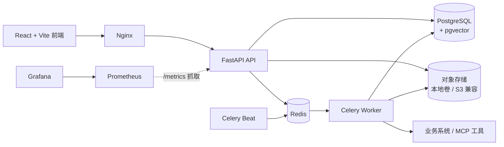
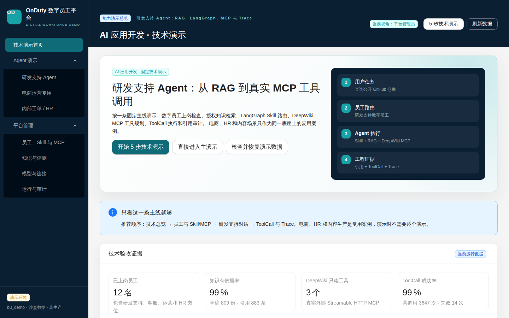
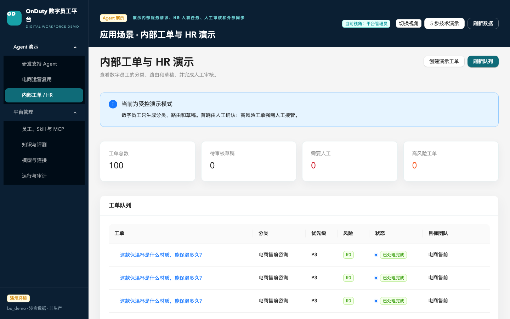
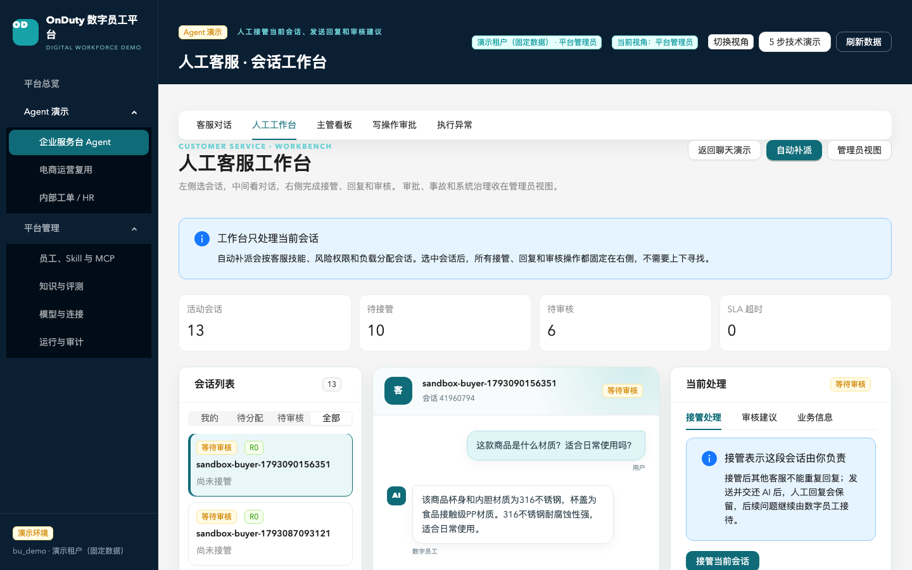
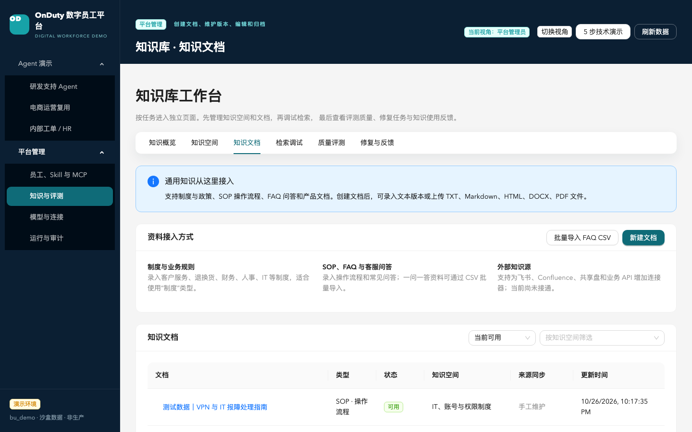
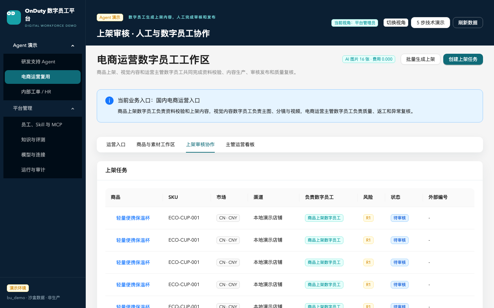
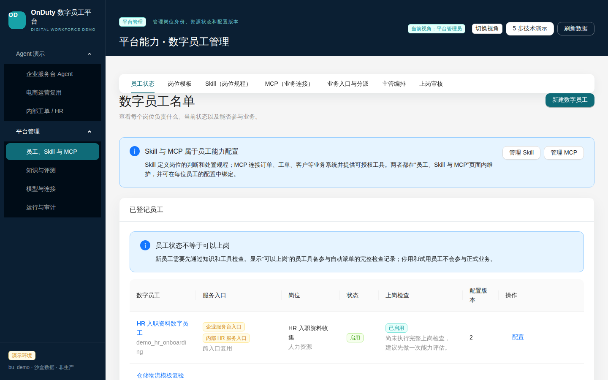

# OnDuty · 数字员工平台（Digital Workforce Platform）

[](https://github.com/github0117/onduty-platform/actions/workflows/ci.yml)

这是一个可验收的数字员工平台能力演示环境。主演示业务为 **国内电商客服与运营**，
覆盖商品知识、订单物流、退款审批、人工接管、商品上架策划、规则检查、素材生产、
短视频、审核和上架资料包导出。

项目定位、7 分钟演示脚本、指标口径和验收证据见
[docs/demo-guide.md](docs/demo-guide.md)。

```text
商品资料
  → 国内规则检索
  → 标题 / 卖点 / 详情 / 短视频脚本
  → 分镜图
  → 竖屏视频与 WebVTT 字幕
  → 人工审核 / 编辑 / 退回
  → 上架资料包导出
```

## 系统架构



## 界面预览

| 演示总览 | 工单与 HR |
| --- | --- |
|  |  |
| **客服工作台** | **知识库** |
|  |  |
| **电商上架审核** | **数字员工配置** |
|  |  |

截图由 `apps/web/e2e/docs-screenshots.spec.ts` 在演示栈上生成。

## 当前能力

- 商品与 SKU 管理。
- 电商规则知识库和引用追踪。
- 受限宣传语检查与人工接管。
- 商品图片、AI 主图、视频和字幕素材。
- 分镜批次隔离和旧素材归档。
- Outbox + Celery 异步视频渲染。
- 缓慢推近、淡入淡出和字幕时间线。
- 标题、卖点、详情和标签的人工编辑与复审。
- 发布成功率、平均上架耗时、人工介入率和视频成功率。
- ZIP 上架资料包导出。
- 电商审计、素材生命周期和成本记录。
- 电商商品按品类档案动态检查必填属性和合规宣传语。
- 千问 DashScope OpenAI 兼容文案生成接口。
- 低成本 `z-image-turbo` 商品图和分镜生成。
- `qwen-vl-ocr` 检查主图和分镜中的多余文字。
- `qwen3-tts-flash` / `Cherry` 生成中文分镜旁白并混入视频。
- Noto Sans CJK 字幕烧录和 48kHz AAC 响度标准化。
- 支持上传真实 BGM、循环裁剪和配音自动闪避。
- CSV 商品模板下载、逐行校验、错误报告和批量创建商品。
- 一次最多选择 10 个商品批量生成上架任务，支持逐项状态、失败隔离和任务关联。
- 能力总览支持管理员一键检查并恢复固定演示数据；恢复幂等、可重复执行、
  不删除手工创建的业务数据，并阻止并发重复运行。
- 知识空间创建与文档动态归类，支持按平台、品类和工作流组织知识。
- 数字员工可绑定多个知识空间，检索与工作流执行均校验空间授权。
- 商品新增或变化后自动生成静态商品知识卡，使用内容哈希避免重复索引。
- 知识评测中心支持召回率、MRR、无答案检测和失败修复任务。
- 关键知识空间可启用发布门禁，评测失败自动回滚并生成修复任务。
- 线上正负反馈可关联知识、员工和工单，负反馈自动生成修复任务。
- 电商售前和售后独立分类路由，售后订单/退款问题强制人工。
- 知识有引用且校验通过的 R0 售前问题可自动回复，无需逐会话人工确认。
- 自动回复受置信度、敏感动作、工具权限和策略审批共同约束；模型 fallback、
  引用声明未校验或校验不通过时一律转人工。
- 客服会话沙盒支持提问、引用、人工改写、点踩和自动修复任务。
- 工作台可从会话自动识别订单，展示客户、物流、售后和收货地址上下文。
- 收货地址修改走 R2 人工审批，支持重复申请幂等、超时结果未知和只读对账；
  沙箱提供正常、超时和明确拒绝三种模式。
- 页头区分“当前操作身份”和“这段对话双方”，身份菜单显示岗位职责；客服聊天在
  平板和手机宽度自动改为上下布局。
- 客服对话进入人工工作台时保留当前会话 ID，往返两个页面仍显示同一条会话；
  人工回复成功后消息立即出现在主对话窗口。
- 演示种子包含 316 不锈钢保温杯商品知识，AI 商品回答具备可检索依据。
- 买家对话页只展示模拟买家视角；内部客服、主管和平台岗位不在客户页面切换。
- 业务入口绑定数字员工池，聊天会话由入口进入并在绑定员工中自动分派。
- 员工路由页面支持维护入口的默认、专业和兜底员工，再配置意图派单规则。
- 电商运营入口绑定商品上架、视觉内容和运营主管数字员工；上架任务与素材显示负责员工。
- 页头不再常驻五角色切换，买家页固定买家视角；业务、管理和平台视角统一切换入口
  收进“5 步演示”设置。
- 买家消息和人工回复点击后立即显示发送中状态，失败恢复原文；切换工作台会话先用
  列表快照立绘并预取详情，避免演示时出现空白或按钮无响应。
- 客服看板展示 R0–R3 四级风险分布，待接管队列与风险/优先级联动。
- 接管后可直接发送人工回复，并可发送同时标记解决和释放客服名额。
- 会话列表可按等待审核、等待人工、我负责和已处理完成切换。
- 会话历史按聊天记录展示，可切换当前工单与全部历史。
- 接管会话后可生成千问人工回复建议，展示知识引用并要求人工确认后发送。
- 人工回复可按专业、简洁或亲和风格交给千问优化，不会自动改写数字承诺。
- 客服回复建议使用 LangGraph 执行 Skill 路由、知识检索和千问生成，并返回节点 Trace。
- Skill 支持数据库配置、版本更新、启停和员工绑定，LangGraph 运行时动态读取。
- MCP 连接器支持注册、Streamable HTTP 健康检查、真实工具发现和员工级授权。
- 已真实验证公开 DeepWiki MCP：发现 3 个只读工具，并成功查询
  `modelcontextprotocol/python-sdk` 的仓库文档结构；该能力用于研发支持员工，
  不代表已经接入企业订单、工单或物流生产系统。
- 研发支持员工已加入企业服务台入口，LangGraph 能规划并执行
  `deepwiki-public.read_wiki_structure` 或 `read_wiki_contents`，ToolCall 成功并
  生成 `source_type=mcp` 引用。
- 公开仓库文档查询按低风险技术文档问题自动处理，不再直接弹人工接管；私有仓库、
  密钥和访问令牌请求仍按安全风险转人工。
- 固定 DeepWiki 文档问题按任务选择只读工具：目录使用 `read_wiki_structure`，
  模块/职责/依赖使用 `read_wiki_contents` 并整理中文摘要，实测约 4–7 秒。
- 技术知识检索会过滤无关 IT、商品和通用制度文档；缺少工具或资料时明确返回
  证据缺口，不再回退到“产品配置支持组”模板。
- “你是谁、能做什么、帮我看看”等身份和澄清问题直接回复，不创建错误工单；
  “它有哪些依赖关系”等追问会继承上一轮公开仓库上下文。
- 完整 GitHub URL 会规范化为 `owner/repo` 并写入会话记忆；后续询问“这个仓库的
  文档结构”时复用同一仓库和工单，不要求重复提供地址。
- LangGraph 可按会话意图规划 MCP 工具；只读工具结果作为实时引用进入千问回复。
- MCP 调用记录工具、参数摘要、耗时、结果和错误；敏感信息统一脱敏。
- 可写 MCP 工具会生成持久化审批单，不会在回复建议阶段直接执行。
- 审批仅允许主管或管理员处理，申请人与审批人必须是不同账号。
- 审批通过后只执行一次，重复请求不会再次触达外部写接口。
- MCP 工具参数按输入 Schema 校验，缺失必填字段时拒绝创建审批。
- 写操作增加确定性策略：校验工单分类、风险、退款金额和硬上限，不依赖模型自行放行。
- 退款金额超过主管阈值时自动提升为管理员审批，超过平台硬上限直接拒绝。
- 外部写调用失败自动生成事故单，区分明确拒绝和执行结果不确定，禁止自动重试。
- 页面支持事故确认、处理人和关闭结论，要求先在订单/资金系统核对真实结果。
- 事故可调用绑定的只读 MCP 工具自动对账，并将真实外部结果写入事故记录。
- Celery Beat 默认每 120 秒对最多 20 个执行结果不确定的事故执行只读对账。
- 补偿动作必须使用 `reverse` 或 `compensate` 工具，并创建新的管理员审批。
- 补偿成功后才允许把“已执行但结果错误”的事故关闭。
- 客服页面提供 MCP 写操作审批列表、审计参数、审批意见和执行结果。
- 电商客服默认进入“聊天演示”，首屏只有对话窗口、买家输入框和简短处理说明。
- 支持商品咨询、物流查询、退款审批快捷提问；买家气泡、数字员工回答和待确认建议
  都以对话气泡呈现，输入框支持 Enter 发送、Shift+Enter 换行。
- 商品咨询使用预置保温杯客服岗位和商品知识，默认带出当前商品；对话结束后可直接继续追问。
- 建议回复尚未发送时会显示为虚线“建议回复”气泡并附知识引用，高风险时明确提示转人工。
- 服务工作台保留会话列表、自动派单、人工接管、SLA、审批、事故、Trace 和 MCP 管理。
- 支持“聊天演示 / 服务工作台 / 管理员视图”三种视图，指标、审批和事故按角色收起。
- 已移除全局“业务视图 / 技术视图”切换。侧边栏只保留“业务演示”和“平台管理”
  两个一级分组；客服、员工、模型等二级页面使用页内横向导航。
- 完整客服工作台收敛为三栏：左侧会话列表、中间对话和审核气泡、右侧接管/审核辅助/业务信息；
  审批、事故和系统治理留在管理员视图。
- 选中会话后自动生成 AI 回复草稿，新买家消息到达后自动刷新，无需逐次点击生成。
- 未接管会话也可预览 AI 草稿；发送消息仍要求先接管，避免多人同时回复。
- 工单分类和风险评估完成后自动派单，按业务单元、技能、风险权限和负载选择坐席。
- 普通坐席直接看到“我的会话”；公共待接管队列仅处理无可用坐席等兜底情况。
- Celery Beat 每 10 秒兜底扫描自动派单，“主管立即补派”仅作为人工补偿操作。
- 自动补派返回分配原因和候选明细，页面可查看技能、风险权限、负载、并发上限和排除原因。
- 在线客服、队列、补派、告警和离线回收均按业务单元隔离，跨租户心跳返回 403。
- 数字员工中心默认使用业务配置视图，技术参数收进管理员高级配置。
- 支持企业服务台、售前、售后、物流和 HR 入职五个岗位模板，自动生成员工编码、
  工作流和默认权限。
- 模板页通过具体模板卡的“使用这个模板”创建员工，不再提供会默认选择首个模板的
  重复顶部入口。
- 已发布自定义模板会进入员工创建选择器，并标记为“自定义已发布”。
- 数字员工配置支持 Manifest、发布版本和更新后自动生成新修订。
- 每名数字员工可配置角色提示词，随配置版本保存，并注入回复建议、工单草稿和主管
  子任务生成；提示词只调整角色、语气和服务边界，不能覆盖安全约束、知识事实和人工
  审批规则。
- 会话可以不指定数字员工，系统按关键词、同义词和本地语义相似度自动选择专业员工。
- 每次路由记录候选员工、主体/背景/同义词命中、关键词分、语义分、综合分、置信度、
  排除原因和最终选择；分数接近时提示人工确认，没有可靠命中时进入低置信度兜底。
- 客服主管数字员工可把复杂目标拆成分步任务，并自动分配售后、物流、主管等员工。
- 主管任务图保存每个子任务的负责人、指令、状态、路由原因、置信度和候选解释；
  子任务主体与完整任务背景隔离，避免退款等背景词覆盖物流等主体能力。
- 主管任务可进入真实执行：专业员工按各自知识库、Skill 和模型产出结果。
- 子任务支持 RUNNING / SUCCEEDED / FAILED、失败重试和主管结果汇总。
- 主管子任务可调用专业员工已授权的只读 MCP 工具，写工具不会进入子任务候选集。
- 工具调用写入子任务 `tool_calls`，实时结果以 `source_type=mcp` 进入结构化引用。
- 后续主管和风险步骤会继承前序专业员工结果，并以 `workflow_step` 引用保留证据链。
- 主管任务卡可展开每个子任务的 ToolCall、耗时、错误和 MCP/前序步骤引用。
- 主管规划后检查每个步骤的员工 Manifest 能力；缺失时返回 `DRAFT_ONLY` 员工草案，
  展示建议模板、能力、Skill 和工具，并阻止任务交给兜底员工执行。
- 支持解析目标中“XX能力：说明”的能力清单；财务、仓储等无现成模板的能力也会生成草案。
- 主管规划同时检查员工状态、工具白名单、知识库、Skill 和实时 MCP 就绪度。
- 能力缺口、资源检查和评估时间以快照保存；员工后续变更不会改写历史规划结果。
- 工具权限或员工状态阻塞时拒绝执行；知识、Skill、MCP 缺失时标记降级并提示人工补证。
- 员工草案支持独立落档、管理员评审、试用员工、资源评测、正式发布和回滚停用。
- 试用员工不参与自动路由；评测通过后才能发布，发布和回滚均生成员工配置修订。
- 被拒绝的草案支持重新打开；提前发布、重复发布、重复回滚和非法状态转换会被拒绝。
- 能力缺口会识别已有草案，重复生成时直接显示状态和草案入口，不会一直停留在加载状态。
- 已验证的员工草案可沉淀为数据库化岗位模板，经批准和发布后用于创建更多员工。
- 自定义模板支持模板草案、批准、拒绝、发布和停用，停用后不能继续创建员工。
- 模板沉淀会快照试用员工实际绑定的 Skill、知识空间、MCP、模型和知识策略。
- 自定义模板创建员工默认进入 TRIAL，继承资源并评测通过后才转为 ACTIVE。
- 员工草案在 DRAFT 状态可编辑；关键状态转换使用数据库行锁。
- 草案创建、编辑、评审、重开、试用、评测、发布和回滚均落不可变版本快照，
  页面可查看修订时间线和操作人。
- 草案和模板拒绝原因由后端强制校验，不能通过绕过前端提交空原因。
- 模板型草案试用会应用草案修改后的能力、意图、Skill 和工具白名单。
- 草案与模板员工的评测、激活共用精确资源校验；发布前用 SHA-256 指纹复验资源，
  评测后删除或替换 Skill、知识空间、MCP、工具会阻止上线并要求重新评测。
- 员工名称、工具、模型、知识、Skill 和 MCP 可通过单个原子配置接口保存；
  任一绑定校验失败会整体回滚，不会留下半套配置。
- ACTIVE 员工的资源或 Skill/MCP 定义发生变化后自动回到 TRIAL，停用员工重新启用
  也必须重新评测；生产环境从内置模板创建员工同样从 TRIAL 开始。
- 知识绑定、MCP 审批单和事故单执行资源级租户校验；主管必须同租户、ACTIVE，
  且具备任务拆解协调能力。
- 主管任务重新检查会重新路由 PENDING 子任务；创建缺失员工后能力缺口可自动消除。
  执行使用原子 QUEUED 抢占，重复提交不会重复派发。
- 模板发布前验证必需 Skill、知识空间、MCP 和工具；发布后资源失效时拒绝克隆。
- 并发创建 Skill、员工、知识空间时唯一键冲突稳定返回 409；重复资源绑定返回 422。
- 自定义模板支持不可变修订历史、拒绝/停用后的重新打开和再次批准发布。
- 多租户身份支持 OIDC `business_units` 声明；开发模式使用
  `X-Business-Unit-Id` / `X-Business-Units`。非开发环境拒绝 `APP_AUTH_MODE=dev`，
  且 OIDC 必须同时配置 issuer 和 audience，缺失时服务拒绝启动。
- 开发环境提供客服坐席、客服主管、知识运营、业务经理、平台管理员五种测试身份，
  并可在“主要演示单元 / 隔离验真单元”之间切换业务上下文。
- Mock Business 作为工单同步、电商发布和物流查询默认 Provider；隔离验真单元
  已写入 120 条工单、30 份知识和 60 条评测题，评测 60/60 通过。
- 全局 API 查询守卫阻止跨租户 `business_unit_id`，全局 JSON 写请求守卫校验请求体租户；
  两者只覆盖显式声明的租户，资源归属由路由和服务层单独校验。
- 工单、知识文档/版本、客服会话、电商资源、AgentRun Trace 和工具调用均按资源
  `business_unit_id` 校验，越权统一返回 `403 BUSINESS_UNIT_ACCESS_DENIED`；
  列表与指标未传租户时回落到当前身份的主业务单元。
- 工单幂等键重放前先校验已有工单归属，避免跨租户通过 409 响应泄露工单 ID。
- 工单状态迁移走显式白名单：自动化流程不能离开终态，客服轮次和人工操作显式
  放行重开；非法跳转返回 `INVALID_WORKFLOW_TRANSITION`，每次迁移保留记录。
- 多租户实现、攻击复现和回归测试见
  [多租户隔离设计](./docs/tenant-isolation.md)。
- 模板克隆保存模板 ID、版本和必需资源快照；激活时按具体 Skill、知识空间、
  MCP 工具集合校验，不只看数量。
- 用户追加知识不会覆盖模板必需知识；模板 DRAFT 可编辑并生成新修订。
- 生产环境强制独立评审人，创建草案或模板的账号不能自行批准。
- 生产环境手工创建员工必须从 TRIAL 开始。
- 前端改为路径路由和路由级懒加载，各主页面独立加载；旧 `?page=...` 地址自动兼容。
- 主入口重组为“技术演示首页、Agent 演示、平台管理”：
  研发支持 Agent 是主演示；电商、内容和工单属于复用案例；员工、知识、模型和审计
  属于平台管理。
- 员工页面内部提供员工、模板、规程、连接、路由、主管编排和发布导航；
  客服页面内部提供“客户服务、工作台、运营看板、待审批操作、执行异常”导航。
- 客服运营三页职责固定：运营看板只展示指标、趋势、告警和待接管队列；
  待审批操作处理尚未执行的外部写操作；执行异常处理失败或结果不确定的操作。
  客户服务测试表单和完整会话列表不再混入运营看板。
- 页头提供“5 步技术演示”引导，从技术总览、员工上岗、真实 MCP、Agent 对话
  走到 ToolCall 与 Trace。
- 客服沙盒明确标记演示入口，并显示“数字员工已完成、处理结论、下一步”的中文解释。
- 客服沙盒边界统一使用“企业消息渠道与外部业务系统消息渠道”，不再把通用客服
  绑定到电商平台；聊天和人工回复都明确只写入本地演示会话。
- 客服日常处理界面随场景切换文案：企业服务台使用制度、账号、IT、内部流程和敏感
  操作术语；电商客服使用商品、物流、售后和退款审批术语。平台管理页面则明确显示
  `Skill（岗位规程）` 和 `MCP（业务连接）`，并提供员工能力配置直达入口。
- 企业服务台和电商客服从“能力演示总览”的独立场景入口进入，客服页面内不再提供
  业务类型切换器；避免把真实坐席渠道误做成手动测试开关。
- 页头身份标签可直接打开角色菜单并切换到对应角色首页，切换后显示“已切换为…”提示；
  业务单元切换收进“5 步演示”的演示设置。正式环境由登录身份和所属业务单元自动确定。
- 客服聊天明确区分“操作身份、业务场景、对话数字员工”；聊天会话按
  `业务单元 + 操作身份 + 业务场景` 隔离，切换身份后不会恢复上一位身份的对话。
- 五步演示、总览边界、知识示例、模型外部集成和员工系统连接使用跨场景文案；
  商品、物流、售后、退款等术语只保留在电商内容、电商客服和电商岗位模板中。
- 平台知识库演示数据同时包含企业服务、客户服务 SOP、IT 与权限、财务、HR 和
  电商渠道知识；知识空间默认只显示当前可用且排除自动化测试域。
- 自动路由结果主表使用员工姓名、中文原因、触发来源和置信度；历史英文原因会
  自动转换，测试员工和停用员工的规则默认不进入“当前生效”视图。
- 知识评测案例按业务单元、知识空间、数字员工和规范化问题去重；相同问题再次创建
  会复用原案例。评测页默认只显示当前启用案例，停用空间会联动停用关联案例。
- 内部工单默认排除已关闭测试工单；分类和目标团队使用中文。E2E 创建的工单自动关闭，
  演示恢复脚本批量归档历史测试前缀，当前默认队列只保留 5 张标准演示工单。
- 员工名单增加“上岗检查”，直接区分可以上岗、待检查、检查未通过和已停用。
- 页面明确标注“已运行 / 沙盒或演示 / 未接入生产”，避免把场景数据误认为生产接入。
- 数字员工能力拆成员工、模板、Skill、MCP、路由、主管任务和草案发布七个二级页面；
  平台菜单和员工页顶部均明确显示 Skill、MCP，不再只使用容易误解的业务别名。
- 管理员可从缺口卡片手动套用模板创建员工；创建前必须填写名称并确认，不会自动上线。
- Nginx 使用 Docker DNS 动态解析 API；重建 API 后无需同步重启 Web，避免旧 IP 造成 502。
- 千问返回短工具名或把参数字段拼进工具 ID 时，只对唯一匹配的已授权工具做严格恢复，
  参数缺失仍走独立受限提取，禁止猜测订单号或金额。
- 证据不足时任务进入 `NEEDS_REVIEW`，不会伪造订单、物流或审批结果。
- 员工中心可绑定 MCP 连接器，并配置允许工具和写权限开关。
- 客服沙盒按品类选择商品，反馈自动归属员工已授权的知识空间。
- 客服会话通过 Conversation Turn Runtime 持久化每一轮执行，支持多轮上下文、
  员工配置快照、知识引用、ToolCall、Trace 和单会话工单复用。
- 客服会话支持接管、释放和乐观锁冲突保护。
- 客服坐席支持在线心跳、当前会话和在线数量统计。
- P0/P1 会话支持主管告警、确认和强制改派。
- 电商品类档案支持动态属性 Schema、客服关键词和禁用宣传语。
- 品类档案已贯通商品校验、CSV 导入、客服分类、会话上下文和知识空间。

当前只开放中国站。跨境市场字段已预留，美国站入口处于禁用状态。

## 千问配置

将密钥只写入本机 `.env`：

```text
ECOMMERCE_CONTENT_PROVIDER=openai_compatible
ECOMMERCE_CONTENT_BASE_URL=https://dashscope.aliyuncs.com/compatible-mode/v1
ECOMMERCE_CONTENT_MODEL_NAME=qwen-plus
ECOMMERCE_CONTENT_API_KEY=<local-secret>
ECOMMERCE_CONTENT_FALLBACK_TO_LOCAL=true
ECOMMERCE_IMAGE_PROVIDER=dashscope
ECOMMERCE_IMAGE_BASE_URL=https://dashscope.aliyuncs.com
ECOMMERCE_IMAGE_MODEL_NAME=z-image-turbo
ECOMMERCE_IMAGE_FALLBACK_TO_LOCAL=true
ECOMMERCE_VISUAL_AUDIT_PROVIDER=dashscope_ocr
ECOMMERCE_VISUAL_AUDIT_MODEL_NAME=qwen-vl-ocr
ECOMMERCE_TTS_PROVIDER=dashscope_qwen
ECOMMERCE_TTS_MODEL_NAME=qwen3-tts-flash
ECOMMERCE_TTS_VOICE=Cherry
```

未配置密钥时继续使用本地模板，页面和素材元数据会标明实际 Provider。

## 物流状态查询

物流状态必须来自订单或物流系统，不能由大模型推断。配置企业 OMS、WMS
或快递查询服务的 HTTP JSON 接口：

```text
LOGISTICS_QUERY_PROVIDER=http_json
LOGISTICS_QUERY_BASE_URL=https://your-logistics-service.example/query
LOGISTICS_QUERY_API_KEY=<local-secret>
LOGISTICS_QUERY_TIMEOUT_SECONDS=20
```

系统向该地址发送：

```json
{
  "order_id": "DEMO-ORDER-001",
  "tracking_number": "SF1234567890",
  "carrier_code": "SF"
}
```

接口应返回统一物流结构：

```json
{
  "order_id": "DEMO-ORDER-001",
  "tracking_number": "SF1234567890",
  "carrier_code": "SF",
  "status": "IN_TRANSIT",
  "status_label": "运输中",
  "latest_event_at": "2026-10-24T12:00:00Z",
  "events": [
    {
      "occurred_at": "2026-10-24T12:00:00Z",
      "location": "杭州转运中心",
      "description": "快件已到达转运中心"
    }
  ]
}
```

`order_id` 和 `tracking_number` 至少提供一个。未配置真实接口时，客服页面会明确
显示“物流查询接口尚未配置”，不会生成虚假物流状态。

## 多租户隔离

平台把租户隔离拆成三层，避免只依赖 URL/body 中间件：

1. 中间件拦截显式声明外部租户的 query 和请求体；
2. 路由与关键服务按资源 `business_unit_id` 校验归属，越权返回
   `403 BUSINESS_UNIT_ACCESS_DENIED`；
3. 列表和指标未传租户时回落到当前身份的主业务单元。

工单、知识文档与版本、客服会话、电商素材与任务、AgentRun Trace 和工具调用均有
跨租户回归测试；工单 `Idempotency-Key` 重放前也会校验已有工单归属。完整威胁模型、
覆盖矩阵、攻击复现命令和取舍说明见
[多租户隔离设计与回归验证](./docs/tenant-isolation.md)。

```bash
cd apps/api
uv run pytest tests/integration/test_tenant_resource_access.py -v
```

## 请求限流

模型、工具和图片/视频生成等昂贵接口按“身份 + 业务单元”做窗口限流，默认每 60 秒
120 次；超限返回 `429 RATE_LIMITED` 并带 `Retry-After`。

- Compose 和 .env.example 默认启用 Redis 固定窗口，多进程共享计数；
- Redis 不可用时降级为进程内滑动窗口，避免限流组件故障导致业务接口整体不可用；
- 测试与本地单进程开发默认关闭，可用 `RATE_LIMIT_ENABLED` 和
  `RATE_LIMIT_BACKEND=redis` 开启；
- 覆盖客服消息、回复建议与优化、知识检索与评测、电商图片/分镜/视频生成、
  MCP 审批执行；
- 不同租户分别计数，一个租户不会占用另一个租户的额度；
- 被拒绝的请求计入 Prometheus 计数器
  `ticket_worker_rate_limit_rejections_total`；该计数器是进程内累计值，多副本部署时
  由 Prometheus 对各副本求和。`infra/prometheus/alerts.yml` 中的
  `TicketRateLimitRejectionsHigh` 会在持续超限时告警。

```bash
cd apps/api
uv run pytest tests/unit/test_rate_limit.py tests/integration/test_rate_limiting.py -v
```

## 请求体大小限制

`MAX_REQUEST_BYTES`（默认 32 MiB）限制 `POST`、`PUT`、`PATCH` 请求体。中间件同时
检查 `Content-Length` 和实际读取的字节数，因此没有长度头的分块上传也会在超限时
立即中止，不会先把整个请求体读入内存。

超限返回 `413 PAYLOAD_TOO_LARGE`，响应仍带 CORS 和 correlation ID 头，前端可以按
统一错误结构展示。上传大文件或调整客户资料前，需要同时调整反向代理和
`MAX_REQUEST_BYTES`。

```bash
cd apps/api
uv run pytest tests/integration/test_request_body_limit.py -v
```

## 验证口径

仓库内的结论都由可重复执行的命令支撑：全量 pytest、Ruff、mypy、TypeScript、
Vite production build 和 Playwright 回归均在 CI 中运行。设计取舍和攻击复现见
[多租户隔离设计与回归验证](./docs/tenant-isolation.md)；只读并发基线的环境、
结果和局限见[只读并发压测](./docs/load-test.md)。

## 运行

前端构建产物 `apps/web/dist` 不随仓库发布，首次运行先安装依赖并构建：

```bash
make install   # uv sync + pnpm install
make build     # 生成 apps/web/dist
docker compose -f infra/compose/docker-compose.yml --profile app up -d
```

API 镜像的 APT 源固定为阿里云，PyPI 源固定为清华镜像；Docker 基础镜像使用本机
BuildKit 缓存，后续构建不再依赖默认海外软件源。

首次打开演示环境时，可进入“能力演示总览”，点击“检查并恢复演示数据”。
该操作会补齐固定员工、知识、客服工单、电商商品、素材和上架任务，
仅允许开发或测试环境的管理员执行。

访问：

- 工作台：<http://127.0.0.1:5173/overview>
- 电商运营：<http://127.0.0.1:5173/ecommerce>
- 数字员工：<http://127.0.0.1:5173/employees/roster>
- 员工草案：<http://127.0.0.1:5173/employees/drafts>
- API 文档：<http://127.0.0.1:5173/docs>

## 验证

```bash
make test
make lint
make typecheck
make build
cd apps/web && pnpm test:e2e:install  # 首次安装测试浏览器
make e2e-web
# 当前执行环境无法启动 macOS 浏览器时，可用官方 Linux 容器：
make e2e-web-docker

# 跨租户越权回归
cd apps/api && uv run pytest tests/integration/test_tenant_resource_access.py -v

# 客户、订单、物流和改址真实接口闭环
make business-sandbox-acceptance

# 最终一键验收
make acceptance-final
```

当前基线：

```text
322 passed，1 skipped（未配置独立 PostgreSQL 测试库；CI 中会运行 pgvector 回归）
Python 测试覆盖率: 87%
Ruff: passed
mypy: passed（171 个源文件）
TypeScript / Vite: passed
GitHub Actions: backend lint/type/coverage + pgvector + frontend build + Playwright E2E
Playwright 浏览器点击回归: 129 passed（21 个测试文件，已纳入 CI）
只读并发基线: 50/100 并发，P95 460.89 / 850.71 ms（docs/load-test.md）
PostgreSQL migration: b1f7a2c9e4d6 (head)
全栈 Smoke: passed
模拟业务系统: passed（成功、幂等、HTTP 500 故障）
客户订单与改址沙箱: passed（审批、幂等、超时未知、对账关闭）
最终验收数据: 120 工单 / 30 份知识 / 60 条评测
```

## 主要技术栈

- React + TypeScript + Ant Design
- Playwright 浏览器点击回归
- FastAPI + SQLAlchemy + Alembic
- PostgreSQL + pgvector
- Redis + Celery + Celery Beat
- MCP Python SDK
- 对象存储（本地卷，S3 兼容接口可选）
- FFmpeg
- Nginx

## 当前限制

- 暂未内置版权音乐库；BGM 需上传已获授权的音频。
- 视频使用程序化镜头效果，尚未接入图生视频模型。
- 文生图可能自行添加文字，OCR 会标记并阻止未确认的分镜合成视频。
- 当前渠道为本地流程验证，不对外发布。
- 外部电商平台 Adapter 尚未接入真实 Sandbox。
- MCP 写操作已支持独立审批和单次执行；外部调用返回不确定结果时仍需要事故处理流程，
  系统不会自动重试写工具。
- MCP 对账和补偿已支持；具体支付、ERP、CRM 的供应商专用补偿 Adapter 仍待接入。
- 坐席技能、风险权限和最大并发已支持通过心跳 API 配置，但尚未提供完整 HR 排班和坐席能力管理页面。
- 企业服务台已使用独立通道和岗位员工；账号、IT、财务等内部服务分类仍需继续拆分，
  当前部分通用问题会按“待分类”进入人工复核。
- 主管任务当前按业务模板拆解固定步骤，尚未实现完全由模型生成任意 DAG 的开放式编排。
- 主管任务已支持只读 MCP 查询和证据回传；退款、发布等写动作仍必须进入独立审批。
- 当前没有外部商城店铺、企业订单和物流接口，验收使用临时 MCP Server 验证协议，不能视为生产业务已接通。
- 数字员工“语义路由”当前使用本地确定性文本相似度，不调用外部 Embedding 或语义模型。
- 当前 MCP 只支持 Streamable HTTP；stdio MCP 仍需容器隔离和命令白名单。
- 岗位模板编辑页目前覆盖静态能力和 Skill/工具；知识空间与 MCP 资源可在后端快照
  和管理、克隆链路中继承，但尚未提供普通运营专用的图形化资源编辑器。
- 草案版本历史已展示快照时间线，尚未提供逐字段差异对比和一键回放旧版本。
- 内置系统模板在开发环境保留快捷 ACTIVE；生产环境仍需从 TRIAL 开始评测。
- 已完成两路并发创建、并发克隆、完整业务链路验收和本地 50/100 并发只读基线，
  尚未使用独立压测机覆盖模型、MCP、写操作，也未做长时间稳定性测试和故障注入。
