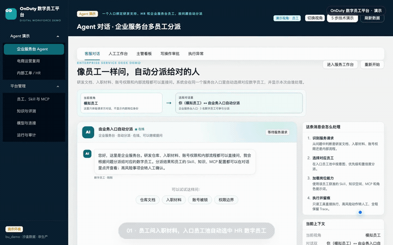
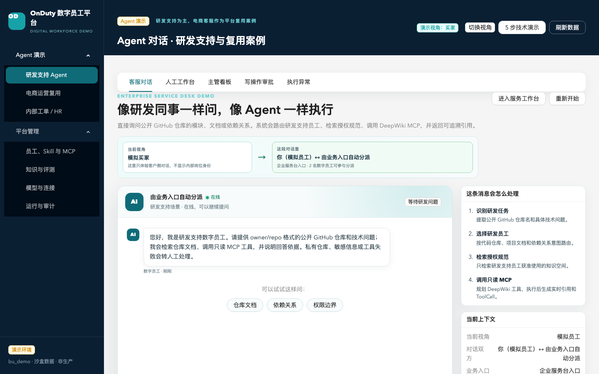
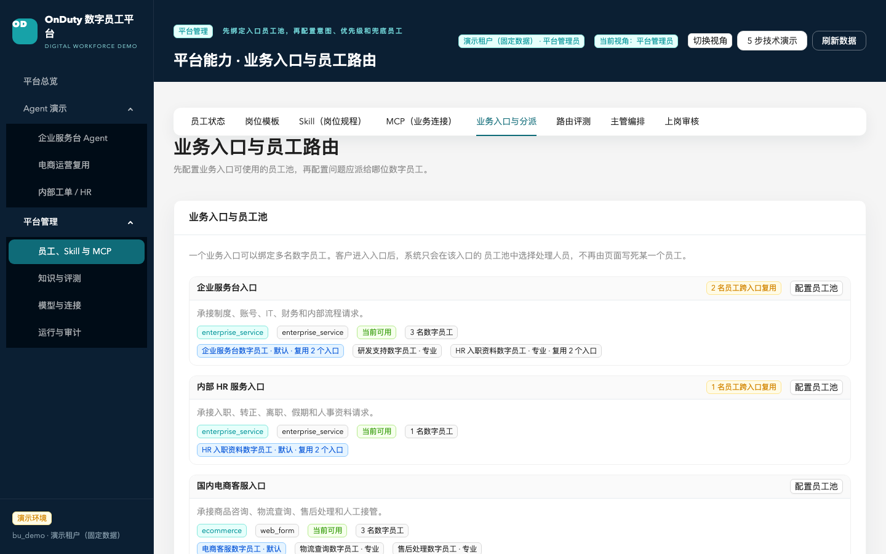
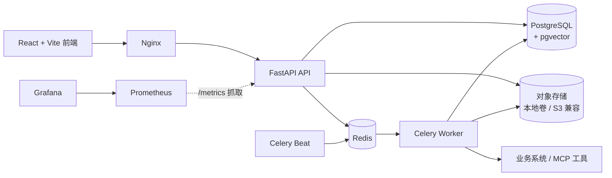

# OnDuty · 数字员工平台

[](https://github.com/github0117/onduty-platform/actions/workflows/ci.yml)

一个多租户数字员工平台：把企业知识、岗位规程（Skill）、模型和 MCP 业务工具，
装配成可上岗、可评测、可审批、可接管、可审计的 AI Agent。

主演示是**企业服务台**：同一入口按问题自动分派研发支持、HR 和企业服务台员工；
电商客服用于验证商品咨询、订单物流、退款审批、人工接管和失败恢复闭环。

<!-- GitHub 播放器在加载元数据前固定为 300×200，且会丢弃 width/height/poster；
     因此用仓库内动图做全宽预览，完整视频放在可展开的内嵌播放器里，避免小窗口和全屏跳转。 -->


> **60 秒演示**：同一入口跨岗位分派 → 员工能力快照 → 意图冲突检查 → 路由评测。
> 上方为动图预览；展开下方播放器可看完整 60 秒视频，不跳转全屏。

<details>
<summary>在页面内播放完整 60 秒视频</summary>

<video src="https://github.com/user-attachments/assets/847fb7a9-c1d5-41ea-be42-0e554dfb8173" controls></video>

</details>

> [MP4 下载](docs/assets/demo/on-duty-routing-demo.mp4) · [WebM](docs/assets/demo/on-duty-routing-demo.webm) · [GIF 预览](docs/assets/demo/on-duty-routing-demo-preview.gif)

## 界面预览

| 企业服务台 Agent | 业务入口与员工池 |
| --- | --- |
|  |  |
| **知识库** | **电商上架审核** |
|  |  |

## 核心能力

- **数字员工装配**：岗位模板、员工、角色提示词、Skill、知识空间、MCP 授权和
  模型策略统一建模；配置版本化，资源变化后自动回到试用并重新评测。
- **入口路由与评测**：业务入口绑定员工池，按意图、关键词和本地语义分派；
  记录候选、分数和排除原因，支持 TUNING / HOLDOUT 评测集与失败分析。
- **RAG 与引用**：知识空间授权检索、文档版本与发布门禁、引用声明校验；
  无依据或校验不通过时转人工，不编造答案。
- **MCP 工具治理**：只读工具自动执行；写工具走确定性策略、独立审批、
  幂等执行、事故对账与补偿审批。
- **客服工作台**：SSE 流式回复、自动派单、人工接管、风险分级、SLA、
  回复建议、反馈修复和审计。
- **多租户与可靠性**：资源级租户校验、统一 403、幂等键、工单状态机白名单、
  限流和请求体上限。

## 系统架构



## 快速开始

需要 Docker、`make`、`uv`、Node.js 和 pnpm：

```bash
make install   # uv sync + pnpm install
make build     # 构建前端到 apps/web/dist
docker compose -f infra/compose/docker-compose.yml --profile app up -d
```

首次打开演示环境，进入“运行与审计”点击“检查并恢复演示数据”；
也可以直接执行 `make seed-demo`。

- 工作台：<http://127.0.0.1:5173/>
- 电商运营：<http://127.0.0.1:5173/ecommerce>
- 数字员工：<http://127.0.0.1:5173/employees/roster>
- API 文档：<http://127.0.0.1:5173/docs>

## 验证

```bash
make test          # 后端测试
make lint          # Ruff
make typecheck     # mypy + TypeScript
make build         # Vite production build
make e2e-web       # Playwright 浏览器回归

# 跨租户越权回归
cd apps/api && uv run pytest tests/integration/test_tenant_resource_access.py -v

# 最终一键验收
make acceptance-final
```

当前基线：

```text
后端: 345 passed, 1 skipped
Python 覆盖率: 88%（CI 门槛 85%）
路由评测: TUNING 36/36；HOLDOUT 16/18（88.9%，含失败分析）
Ruff / mypy: passed（175 个源文件）
TypeScript / Vite: passed
Playwright: 140 passed, 2 skipped（24 个测试文件）
只读并发: 50/100 并发，P95 460.89 / 850.71 ms
PostgreSQL migration: e7a1c3d5b9f2 (head)
模拟业务系统: passed（成功、幂等、HTTP 500 故障）
```

## 技术栈

React + TypeScript + Ant Design · FastAPI + SQLAlchemy + Alembic ·
PostgreSQL + pgvector · Redis + Celery · LangGraph · MCP Python SDK ·
Playwright · Docker Compose · Nginx · FFmpeg

## 项目文档

- [演示与验收说明](docs/demo-guide.md)：项目定位、7 分钟演示脚本、指标口径和验收证据
- [完整能力清单](docs/features.md)：平台全部功能细节
- [模型与外部集成配置](docs/configuration.md)：千问、物流、限流和请求体上限
- [多租户隔离设计与回归验证](docs/tenant-isolation.md)
- [只读并发压测](docs/load-test.md)

## 当前限制

- 演示栈运行在本地 Compose，业务系统使用 Mock Business，尚未接入真实企业订单、
  物流和资金系统。
- 语义路由使用本地确定性文本相似度，未调用外部 Embedding 或语义模型。
- 视频使用程序化镜头效果，未接入图生视频模型；BGM 需上传已获授权的音频。
- MCP 当前只支持 Streamable HTTP；写操作必须审批，结果不确定时进入事故对账，
  不会自动重试。
- 生产级压测、企业 OIDC、真实消息渠道和安全评审仍待完成。
