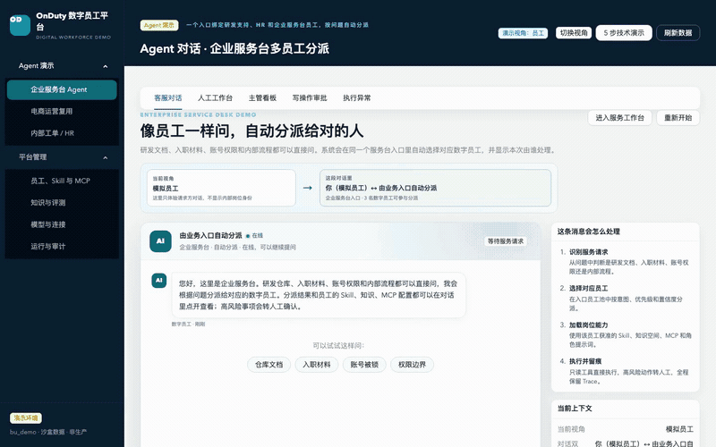
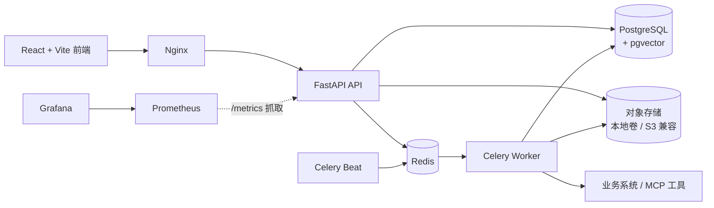

# OnDuty · 数字员工平台

[](https://github.com/github0117/onduty-platform/actions/workflows/ci.yml)

一个多租户数字员工平台：把企业知识、岗位规程（Skill）、模型和 MCP 业务工具，
装配成可上岗、可评测、可审批、可接管、可审计的 AI Agent。

主演示是**企业服务台**：同一入口按问题自动分派研发支持、HR 和企业服务台员工；
电商客服用于验证商品咨询、订单物流、退款审批、人工接管和失败恢复闭环。

<!-- GitHub 的 README 只允许 user-attachments 视频从 S3 播放；部分 Chrome 网络无法访问
     该域名，播放器会停在 0:00。这里用仓库内 60 秒全幅动图做浏览器通用内嵌演示，
     带进度条的 MP4 作为下载版本。 -->


> **60 秒完整演示**：同一入口跨岗位分派 → 员工能力快照 → 意图冲突检查 → 路由评测。
> 上图为完整演示动图（循环播放），Chrome / Safari 均可直接观看；带进度条的 MP4 见下方下载链接。
>
> [MP4 下载](https://github.com/github0117/onduty-platform/raw/main/docs/assets/demo/on-duty-routing-demo.mp4) · [WebM 原片](https://github.com/github0117/onduty-platform/raw/main/docs/assets/demo/on-duty-routing-demo.webm) · [8 秒轻量预览](docs/assets/demo/on-duty-routing-demo-preview.gif)

## 界面预览

| 企业服务台 Agent | 业务入口与员工池 |
| --- | --- |
|  |  |
| **知识库** | **电商上架审核** |
|  |  |

## 核心能力

- **数字员工装配**：岗位模板、员工、角色提示词、Skill、知识空间、MCP 授权和
  模型策略统一建模；配置版本化，资源变化后自动回到试用并重新评测。
- **入口路由与评测**：业务入口绑定员工池，按意图、关键词和本地语义分派；
  记录候选、分数和排除原因，支持 TUNING / HOLDOUT 评测集与失败分析。
- **RAG 与引用**：知识空间授权检索、文档版本与发布门禁、引用声明校验；
  知识评测区分 TUNING / HOLDOUT，留出集只读并用于发布门禁，指标含
  chunk/文档级 Recall、MRR、context precision 和负例违规率；
  CI 通过 `rag-gate` 用冻结 HOLDOUT 和阈值退出码做回归；
  低分查询可选 LLM 多查询改写（默认关闭，失败回退本地结果）；
  默认配置推荐 DashScope `text-embedding-v3`，未配置密钥时降级为
  `local-hash-256` 演示模式：`/metrics/rag` 返回 `embedding_quality=demo`，
  运营页显式提示“检索质量不代表语义检索水平”；评测用例支持段落级期望
  （`expected_passages`），页面可直接选择文档并录入原文片段，重建索引后无需
  改写，最近运行会展示平均上下文字符数/估算 token 和未解析段落原因；
  真实 embedding 与远端 rerank 已做协议和公开集 A/B，远端 rerank 默认仍关闭；
  无依据或校验不通过时转人工，不编造答案。
- **MCP 工具治理**：只读工具自动执行；写工具走确定性策略、独立审批、
  幂等执行、事故对账与补偿审批。
- **外部连接中心**：邮件渠道（IMAP 收信 / SMTP 回信）与只读 HTTP JSON 业务系统
  共用一套连接器注册、密钥环境变量引用、签名 Webhook、幂等入站台账、Outbox
  重试和管理页面；邮件来信会进入客服会话、工单和数字员工回答链路。
- **客服工作台**：SSE 流式回复、自动派单、人工接管、风险分级、SLA、
  回复建议、反馈修复和审计。
- **多租户与可靠性**：资源级租户校验、统一 403、幂等键、工单状态机白名单、
  限流和请求体上限。
- **服务端 RBAC**：角色到能力只由后端维护，`GET /api/v1/me` 下发能力快照；
  菜单、路由和按钮按同一清单渲染，越权页面显示 403，只读角色不出现写操作入口。
- **会话运行时**：买家消息生成带状态机的轮次（`PENDING → RUNNING →
  COMPLETED / NEEDS_HUMAN / FAILED_RETRYABLE / FAILED_TERMINAL / CANCELLED`），
  每次状态变化追加不可变事件；租约超时由后台任务回收重派发，失败可重试轮次
  支持运营手动重试；上下文装配记录用到的消息、记忆、交接摘要和预算快照，
  工作台“运行回放”抽屉可逐轮查看事件、门禁、Skill 与完成度。
- **答案门禁与 Skill 契约**：每轮按 `AUTO_SEND / HUMAN_REVIEW / BLOCK` 三态
  决定能否自动发送，只有依据全部校验通过才自动回信；Skill 以版本化契约描述
  必做步骤和完成标准，每轮冻结快照，编辑 Skill 不会改动历史判定。
- **交接与人工接管**：自动改路由、主管切换员工、人工接管和人工交还都落库为
  交接记录并带确定性摘要，下一轮装配直接读取；接管期间数字员工不插话，
  取消在途轮次，买家新消息只等人工。
- **并发正确性**：会话串行、`client_message_id` 幂等、轮次事件序号在行锁内
  分配；接管/交接/人工回复与 worker 之间的 PostgreSQL 死锁由有界重试吸收，
  `scripts/stress_runtime_concurrency.py` 用真实栈跑接管、交接和重复消息竞态，
  并可按需注入确定性死锁。

## 系统架构



## 快速开始

需要 Docker、`make`、`uv`、Node.js 和 pnpm：

```bash
make install   # uv sync + pnpm install
make build     # 构建前端到 apps/web/dist
docker compose -f infra/compose/docker-compose.yml --profile app up -d
```

试点部署前先跑 `make db-backup` 与 `make preflight`：前者导出并校验数据库，
后者检查 `.env`、硬编码密钥、服务状态、迁移版本（必须恰好等于镜像 head）、
健康探针、嵌入模式与鉴权模式。migrate 服务在升级前后都会校验版本，数据库版本
不可达时不会启动 api。完整步骤与回滚流程见
[上线检查清单](docs/go-live-checklist.md)。

首次打开演示环境会以平台管理员进入“平台总览”，可先查看各类内容的真实数量，
再点击“进入 60 秒主演示”。需要补齐固定数据时，进入“运行与审计”点击
“检查并恢复演示数据”；任务只作用于 `bu_demo`，在后台执行并轮询状态，也可以
直接执行 `make seed-demo`。页头可切换客服坐席、客服主管、知识运营、业务经理、
审计员和平台管理员六种演示身份，菜单、按钮和页面访问权限随身份即时变化。

运行与审计页的“业务价值（近 N 天）”卡片汇总草稿审核结果与模型成本：采纳率只统计
人工已审核草稿，自动通过与待审核单独计数，并给出单会话、单采纳草稿的模型成本，
支持 7/30/90 天窗口切换。

知识库“答案抽检”页（`/knowledge/answer-quality`）对待抽检的已采纳草稿逐条给出
正确/部分正确/错误与幻觉标记，并汇总抽检覆盖率、正确率和幻觉率；需知识运营或
平台管理员身份提交结论，审计员等只读角色只能查看队列。未通过的抽检会进入
“最近未通过抽检”清单，可一键生成知识修复任务；“修复与反馈”页的“知识缺口
Top 10”合并修复任务、负反馈聚类与未处理的抽检失败，给出下一步补录优先级。

- 平台总览：<http://127.0.0.1:5173/overview>
- 主演示 · 企业服务台：<http://127.0.0.1:5173/customer-service>
- 人工工作台：<http://127.0.0.1:5173/customer-service/workbench>
- 电商运营：<http://127.0.0.1:5173/ecommerce>
- 数字员工：<http://127.0.0.1:5173/employees/roster>
- API 文档：<http://127.0.0.1:5173/docs>

## 验证

```bash
make test          # 后端测试
make lint          # Ruff
make typecheck     # mypy + TypeScript
make build         # Vite production build
make e2e-web       # Playwright 浏览器回归

# 跨租户越权回归
cd apps/api && uv run pytest tests/integration/test_tenant_resource_access.py -v

# 会话运行时写路径并发验收（真实栈，含交接竞态与强制死锁注入）
cd apps/api
uv run python scripts/stress_runtime_concurrency.py http://127.0.0.1:8000 -n 20 --force-deadlocks

# 最终一键验收
make acceptance-final
```

当前基线：

```text
后端: 653 passed, 2 skipped（PostgreSQL 专项按 TEST_POSTGRES_URL 启用）
Python 覆盖率: 88%（CI 门槛 85%）
路由评测: TUNING 36/36；HOLDOUT 16/18（88.9%，含失败分析）
Ruff / mypy: passed（206 个源文件）
TypeScript / Vite: passed
Playwright: 174 passed, 2 skipped（5.4 分钟）
只读并发: 50/100 并发，P95 460.89 / 850.71 ms
PostgreSQL migration: e1a7c4d90b62 (head)
会话运行时压测: 20 次接管 + 10 次交接 + 3 次强制死锁，全通过
模拟业务系统: passed（成功、幂等、HTTP 500 故障）
```

## 技术栈

React + TypeScript + Ant Design · FastAPI + SQLAlchemy + Alembic ·
PostgreSQL + pgvector · Redis + Celery · LangGraph · MCP Python SDK ·
Playwright · Docker Compose · Nginx · FFmpeg

## 项目文档

- [演示与验收说明](docs/demo-guide.md)：项目定位、7 分钟演示脚本、指标口径和验收证据
- [完整能力清单](docs/features.md)：平台全部功能细节
- [上线检查清单](docs/go-live-checklist.md)：部署、备份、迁移校验与回滚
- [模型与外部集成配置](docs/configuration.md)：千问、物流、限流和请求体上限
- [多租户隔离设计与回归验证](docs/tenant-isolation.md)
- [只读并发压测](docs/load-test.md)

## 当前限制

- 演示栈运行在本地 Compose，业务系统使用 Mock Business，尚未接入真实企业订单、
  物流和资金系统。
- 语义路由使用本地确定性文本相似度，未调用外部 Embedding 或语义模型。
- 视频使用程序化镜头效果，未接入图生视频模型；BGM 需上传已获授权的音频。
- MCP 当前只支持 Streamable HTTP；写操作必须审批，结果不确定时进入事故对账，
  不会自动重试。
- 生产级压测、企业 OIDC、真实消息渠道和安全评审仍待完成。
