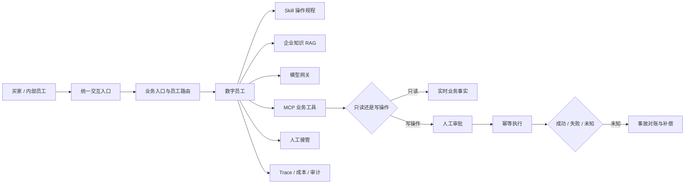

# OnDuty 数字员工平台演示与验收说明

## 项目定位

这是一个面向企业数字员工的 AI Agent 运行底座演示，不是单一电商客服工具。

平台把知识库、Skill、模型、MCP 工具、权限、审批、人工接管和审计装配为可上岗的
数字员工。当前以电商客服为主场景，并保留企业服务台、HR 入职工单和电商运营作为
平台复用验证。

## 一句话介绍

> 我用 FastAPI、PostgreSQL、Redis、Celery、LangGraph、React 和 MCP 实现了一个
> 多租户数字员工平台：把 RAG、Skill、模型和业务工具装配成可评测、可审批、可接管、
> 可审计的 Agent，并通过电商客服跑通问答、工具调用、高风险审批和失败恢复闭环。

## 30 秒版本

> 我这个项目的重点不是接一个大模型，而是解决 Agent 真正落地时的工程问题：
> 我怎么组织 RAG 和 Skill 路由，怎么用 LangGraph 控制节点和状态，怎么通过 MCP
> 调业务工具，怎么用审批、幂等、对账和审计避免模型乱执行。当前 320 个后端测试
>（87% 覆盖率）和 129 个历史页面场景覆盖了权限、跨租户越权、并发、失败恢复和
> 旧数据兼容。

## 用户问题

目标用户包括三类：

| 用户 | 核心问题 |
|---|---|
| 业务负责人 | 客服、运营和内部服务量大，希望 AI 处理高频问题，但不能失控 |
| 平台管理员 | 每做一个 AI 场景都重新开发，缺少统一的员工、知识和工具配置方式 |
| 一线员工 | 需要 AI 提高处理效率，同时能查看依据、接管高风险任务并对结果负责 |

项目不是以“接入更多模型”为目标，而是解决 AI 进入业务流程后的四个问题：

1. 回答有没有企业知识依据。
2. 数字员工是否有明确的岗位、权限和工具边界。
3. 高风险操作是否必须有人审批和兜底。
4. 出错后能否定位、对账、补偿和复盘。

## 产品范围

### 主场景：电商客服

```text
买家提问
  → 意图分类与风险分级
  → 业务入口选择数字员工
  → Skill 路由与知识检索
  → 只读 MCP 查询业务事实
  → 自动回复
  → 高风险写操作进入人工审批
  → 人工接管、对账与审计
```

覆盖的问题：

- 商品参数、材质、使用方式等知识问答。
- 订单、物流等实时业务事实查询。
- 退款、改地址等高风险动作审批。
- AI 回复依据、拒答、人工改写和负反馈修复。
- 工具超时、执行结果未知、只读对账和补偿。

### 复用场景

- 企业服务台：制度、账号、IT 和内部流程。
- HR 入职：资料收集、任务分派和人工复核。
- 电商运营：商品上架、视觉内容、短视频和审核。


## 系统架构



技术关键词只在被问到时展开：

- LangGraph：回复建议中的 Skill 路由、知识检索、MCP 规划和生成节点。
- RAG：文档版本、发布、授权空间检索、引用和质量评测。
- MCP：工具发现、员工级授权、只读查询、写操作审批和结果审计。
- 可靠性：幂等、乐观锁、失败恢复、只读对账、补偿审批和租户隔离。

## 关键产品决策

| 决策 | 取舍 | 演示表达 |
|---|---|---|
| 先做单场景 MVP | 不在第一版覆盖所有岗位 | 先用电商客服跑通业务闭环，再把能力沉淀为模板 |
| 模型是耗材，平台是主体 | 不自建基础模型 | 模型可切换，长期价值在员工配置、知识和治理 |
| 数字员工有独立身份 | 不把 AI 当作聊天窗口 | 岗位、权限、版本和审计都绑定到员工 |
| 高风险动作不自动执行 | 牺牲部分自动化率 | 用审批、幂等和对账换取资金与业务安全 |
| 知识必须可失效 | 避免长期使用过期制度 | 文档有版本和发布状态，员工只读取已发布知识 |
| 员工需要上岗评测 | 不提供“创建即生产可用” | 资源指纹变化后自动回到试用，重新核验 Skill、知识、MCP 和工具 |

## 最值得讲的问题与修复

### 1. AI 建议有了，人工无法安全执行

问题：普通聊天机器人只能生成回复，退款和改址仍需要跨系统操作。

处理：把高风险动作拆成确定性策略、独立审批、幂等执行和工具审计；申请人与审批人
不能相同；外部超时后不盲目重试。

体现能力：业务流程设计、风险控制、幂等和异常恢复。

### 2. 会话在聊天页和工作台对不上

问题：进入工作台后选中了另一条会话，人工回复完成后还可能短暂消失。

处理：通过 URL 传递会话 ID，使用列表快照即时渲染，乐观更新并在失败时回滚，
回复成功后写回会话缓存。

体现能力：真实使用走查、前后端状态一致性、异步交互体验。

### 3. 功能越来越多，但演示越来越混乱

问题：角色、业务场景、员工和页面边界混在一起，用户不知道当前是谁在处理什么。

处理：买家页固定买家视角；内部身份收进演示设置；按客服、工作台、审批、异常拆分
页面；删除重复技术视图；保留唯一主业务路线。

体现能力：信息架构、范围控制和非技术用户视角。

### 4. 一个全局幂等键差点泄露另一个租户的工单

问题：多租户最初只依赖 query/body 中间件，按资源 ID 的接口没有归属校验。
用两个租户实测，beta 可以读取 alpha 工单并执行接管；工单幂等键全局唯一，
beta 复用 alpha 的 `Idempotency-Key` 还会在 409 响应里拿到 alpha 的 `ticket_id`。

处理：中间件只负责显式租户声明；按 ID 的路由先取资源再校验
`business_unit_id`，关键写操作在 service 层兜底；列表和指标缺省回落到当前身份的
主业务单元；SSE、上传和批量任务都在副作用之前校验。新增 6 个跨租户回归测试，
并用 ORM 复查越权请求没有产生状态变更或额外 OutboxEvent。

体现能力：威胁建模、资源级授权、幂等设计和回归测试。

## 验证证据

当前仓库已有：

- Python 全量测试：320 passed，1 skipped，覆盖率 87%。
- 跨租户回归：6 个测试覆盖工单、知识、客服、电商和可观测接口。
- 自动回复验收：引用声明逐条校验，fallback、未校验或不支持的声明一律转人工；
  默认启用本地校验器，生产环境拒绝 `APP_AUTH_MODE=dev`。
- 状态机：工单迁移走显式白名单，自动化流程不能离开终态，非法跳转被拒绝并留痕。
- 生产认证：OIDC 模式下忽略开发身份头，校验签名算法、issuer、audience、过期时间和
  签名密钥，缺失业务单元声明的令牌直接拒绝。
- MCP 审批：活动审批按请求指纹建部分唯一索引，并发重复请求返回同一审批而不是
  创建副本；被拒绝的申请不阻塞重新提交。
- 请求限流：昂贵接口按身份和业务单元限流，Redis 不可用时降级为进程内计数；
  超限返回 `429 RATE_LIMITED` 和 `Retry-After`，并计入
  `ticket_worker_rate_limit_rejections_total`，配套 Prometheus 告警。
- 请求体上限：`POST`/`PUT`/`PATCH` 默认限制 32 MiB，同时校验 `Content-Length`
  和实际流式读取字节数，超限返回 `413 PAYLOAD_TOO_LARGE`。
- GitHub Actions CI：后端 lint / 类型检查 / 覆盖率门槛 85%，Postgres + pgvector
  回归，前端 TypeScript 检查和 production build，以及完整 Playwright 页面回归
  （启动 Compose 栈、写入演示数据后运行 129 个用例）。
- Playwright：129 个页面用例已纳入 CI。
- Ruff、mypy、TypeScript 和 Vite production build 通过。
- 可重复 Mock Business：成功、幂等和 HTTP 500 故障。
- 120 条工单、30 份知识、60 条评测问题组成的模拟验收语料。
- 真实外部 DeepWiki MCP：Streamable HTTP 连接、3 个只读工具发现，并成功查询
  `modelcontextprotocol/python-sdk` 的仓库文档结构。
- Agent 工具规划链路已验收：Skill 路由、知识检索、DeepWiki 工具规划、工具执行和
  MCP 实时引用均出现在同一次 Trace 中。
- 企业服务台、电商客服、HR、知识运营和平台管理员走查记录。
- 多租户威胁模型、覆盖矩阵和攻击复现见
  [多租户隔离设计与回归验证](docs/tenant-isolation.md)。
- 模块验收矩阵和最终验收报告。

测试数量只能证明工程投入，不能代替业务效果。演示验收时应优先确认：

1. 哪条真实流程从开始到结束跑通。
2. 哪个失败场景被正确阻断。
3. 哪个指标因此变得可观测。
4. 哪些结果仍然没有真实验证。

## 7 分钟技术演示脚本

### 0:00–0:40 技术问题与边界

讲解词：

> 这个项目处理的是 Agent 工程闭环：知识如何授权检索、模型如何选择工具、
> 高风险动作如何审批、外部超时如何对账，以及调用链如何观测和审计。

展示：能力总览和四层架构。

### 0:40–1:40 数据模型与员工配置

展示：岗位模板 → 员工 → Skill → MCP → 知识空间 → 上岗检查。

讲解词：

> 员工、模板、知识空间、Skill、MCP、模型策略和版本修订分别建模。配置通过单事务
> 保存，任一资源失效都会让员工回到试用并重新执行资源评测。

### 1:40–3:10 RAG 与 Skill 路由

展示：用户询问 `modelcontextprotocol/python-sdk` → 路由研发支持员工 → 命中
《DeepWiki 研发仓库查询规范》→ 展开引用和 Skill Trace。

讲解词：

> LangGraph 先按 Skill 触发条件路由，再从员工获准使用的已发布知识空间检索。
> 这里的知识不是产品宣传，而是研发支持员工可执行的工具使用规范；关键事实必须
> 绑定引用，无依据时拒答。

### 3:10–4:20 MCP 工具调用

展示：LangGraph 选择 `read_wiki_structure` → DeepWiki 返回真实仓库目录 → 回复引用 MCP 结果。

讲解词：

> 模型只看到员工级授权且已经发现过的工具。每次调用记录参数摘要、结果、耗时、
> 错误和 correlation ID。这里的工具调用已经真实触达外部 DeepWiki MCP，
> 不是本地 Mock，并生成 `source_type=mcp` 的实时引用。

### 4:20–5:20 权限边界与失败恢复

展示：私有仓库或敏感信息请求 → 拒绝进一步查询；外部 MCP 失败 → 转人工；
高风险写工具 → 审批、幂等执行和事故对账；切换到“隔离验真单元”后，
默认列表看不到主单元数据，按 ID 打开主单元工单返回 403。

讲解词：

> 工具开放不代表权限开放。研发支持员工只允许公开仓库只读工具；其他业务中的退款、
> 补偿等写操作仍由确定性策略、独立审批、乐观锁和对账控制。租户隔离同样不是只靠
> 请求头：每个按 ID 的资源读写都会校验归属，跨租户直接 403。

### 5:20–6:20 可观测与测试

展示：运行与审计 → 模型成本、ToolCall、Trace、接管率和异常分布。

讲解词：

> 运行侧记录模型用量、ToolCall、Trace、知识引用、人工介入和异常；工程侧有 320 个
> Python 测试、87% 覆盖率，覆盖权限拒绝、跨租户越权、重复请求、并发冲突、工具失败
> 和旧数据兼容，CI 里还有 Postgres + pgvector 回归。

### 6:20–7:00 边界与下一步

讲解词：

> 当前已跑通真实公开 MCP，但企业订单、物流和资金系统仍未联调，也没有生产级压测。
> 下一步优先做 40 条独立样本、企业 Sandbox 和并发压测，而不是继续增加页面。

## 业务指标口径

对外展示前至少完成一轮独立试点。测试集不能在发布前用于反复调 Prompt 或规则。

| 指标 | 计算方式 | 目标方向 | 当前真实结果 |
|---|---|---|---|
| 任务完成率 | 正确完成数 / 有效任务数 | 越高越好 | 待试点 |
| 首次响应耗时 P50/P90 | 从用户发出到首条回复 | 越低越好 | 待试点 |
| 平均处理耗时 | 从任务开始到人工确认完成 | 越低越好 | 待试点 |
| 自动解决率 | 无人工接管且任务正确 / 全部任务 | 越高越好 | 待试点 |
| 人工接管率 | 人工接管任务 / 全部任务 | 高风险不漏、低风险尽量低 | 待试点 |
| 引用支持率 | 关键事实有有效引用的回答 / 全部回答 | 越高越好 | 待试点 |
| 错误动作率 | 参数、权限或业务动作错误 / 全部动作 | 越接近 0 越好 | 待试点 |
| 单任务模型成本 | 模型和工具成本 / 完成任务数 | 越低越好 | 待试点 |
| 返工率 | 人工修改或退回 / 全部 AI 结果 | 越低越好 | 待试点 |

建议按场景分层统计：

- 知识问答。
- 实时查询。
- 高风险审批。
- 应拒答 / 信息不足。
- 工具失败 / 结果未知。

只报总体平均值会掩盖高风险场景的问题。

## 模拟试点验收样例

以下状态只用于验收业务闭环，不能作为降本增效结果。

- 普通商品咨询：自动回答，附知识引用。
- 物流查询：调用只读 MCP，返回实时沙盒事实。
- 退款请求：自动识别为高风险并转人工。
- 改地址：创建独立审批，重复提交复用同一审批。
- 外部超时：进入结果未知事故，只读对账后关闭。
- 无知识问题：拒答或转人工，不编造答案。
- 未授权用户：不能查看审批、事故和员工配置。
- 已停用员工：不参与自动路由。

## 常见技术问题

### 为什么先做电商客服？

回答：高频、规则较清晰、结果可衡量，而且同时包含知识问答、实时查询和资金风险，
适合验证数字员工底座。

### 为什么不用现成客服 SaaS？

回答：SaaS 能解决单场景客服，但无法证明企业内部的员工、知识、Skill、工具和审批
如何复用。项目目标是验证平台层，不是重做客服 SaaS。

### 这是不是只是 Prompt 工程？

回答：Prompt 只是其中一层。项目还包含员工生命周期、资源绑定、知识版本、工具授权、
风险策略、审批、幂等、事故对账、租户隔离和审计。

### 为什么采用 LangGraph？

回答：回复建议需要把 Skill 路由、知识检索、工具规划和生成拆成可观测节点。
LangGraph 负责状态和条件流转，但退款等高风险动作仍由确定性代码控制，不交给图自由决定。

### 怎么做 Agent 的失败恢复？

回答：写操作区分成功、明确失败和结果未知。结果未知时不自动重试，而是生成事故，
通过只读 MCP 对账确认真实状态；补偿动作必须重新审批，成功后才能关闭事故。

### 怎么做多租户隔离？

回答：中间件只负责拦截显式声明外部租户的 query/body，真正的隔离靠资源级校验：
按 ID 的读写先取资源，再校验 `business_unit_id`，越权返回 403；列表和指标缺省回落
到当前身份的主业务单元。关键写操作在 service 层兜底，SSE、上传、批量任务都在
副作用前校验。还修过一个全局幂等键导致的跨租户工单 ID 泄露，并补了 6 个回归测试。

### 目前技术层面最大的短板？

回答：真实企业业务系统尚未联调，没有生产压测；已接入公开 DeepWiki MCP。
LangGraph 目前主要覆盖回复建议链路，完整员工生命周期仍有部分由确定性服务代码
实现，不是任意 DAG 执行器。

### 有没有真实业务效果？

回答：当前只有模拟试点和工程验收，没有真实企业收益。这一点必须明确。下一步会用
独立留出集和真实业务人员做限定试点，再补量化结果。

### 为什么评测是 100%？

回答：这是受控验收语料，不代表开放场景准确率。更应展示独立留出集、失败样本
和错误分类，而不是把受控集结果当成生产效果。

## 目前还缺什么

按影响优先级排列：

1. 40 条独立样本的对照结果和失败分析。
2. 7 分钟技术录屏，重点讲架构、LangGraph、MCP、幂等和恢复。
3. 推送到 GitHub 的干净仓库、架构图、截图和启动说明。
4. 再接一个真实企业业务 Sandbox；公开 DeepWiki MCP 已完成协议和只读工具验证。
5. 50–100 并发的基础压测和 P95 / 错误率结果。
6. 在线访问地址和剩余生产项：企业 OIDC、真实消息渠道、订单物流接口和安全评审。

## 相关材料

设计与验证说明见
[多租户隔离设计与回归验证](tenant-isolation.md)。
